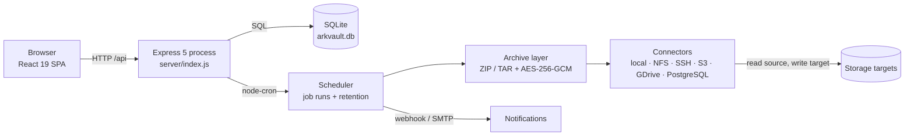

# ArkVault 🛡️

[](https://github.com/arkaitz97/arkvault/actions/workflows/ci.yml)
[](LICENSE)

ArkVault is a self-hosted backup manager for people who keep data on more than one
kind of storage. Instead of one cron script per target, you define a connector
(local folder, NFS, SSH/SFTP, S3, Google Drive or PostgreSQL), point a scheduled
job at it, and get one history view, one retention policy and one restore path.
Backups are archived as ZIP or TAR, optionally encrypted with AES-256-GCM and
checksummed with SHA-256, so a restore can prove the bytes it returns are the
bytes that were written.

Built with React 19 and Node.js (Express 5, SQLite). MIT licensed.

## Features

- 🔌 **Multiple connectors** — Local, NFS, SSH/SFTP, S3-compatible, Google Drive, PostgreSQL
- 📅 **Scheduled backups** — cron expressions, incremental mode, ZIP or TAR/TAR.GZ
- 🔄 **Restore** — browse an archive and restore single files or whole trees
- 🔐 **Encryption and integrity** — optional AES-256-GCM encryption, SHA-256 verification
- 🎯 **Retention** — automatic cleanup of old backups
- 👥 **Multi-user** — admin, operator and viewer roles, plus bearer API tokens
- 🔔 **Notifications** — webhook and email on success or failure

## Architecture

One Node process serves the API, runs the scheduler and drives the connectors. The
React build is served by the same process in production; in development Vite runs
separately and proxies `/api`.



| Path | Contents |
|------|----------|
| `src/` | React frontend (pages, components, API client) |
| `server/` | Express API, routes, scheduler, connectors, SQLite schema |
| `tests/unit/` | Vitest unit tests (backend modules, frontend API client) |
| `tests/integration/` | Supertest API tests and security checks |
| `tests/e2e/` | Playwright browser workflows |

## Run locally

Requires Node.js 18 or newer and npm.

```bash
git clone https://github.com/arkaitz97/arkvault.git
cd arkvault
npm install
npm run start
```

- Frontend: http://localhost:5173
- API: http://localhost:3001

The first run creates `server/arkvault.db` with an `admin` / `admin123` account.
Change that password after logging in. `npm run db:reset` restores it.

Helper scripts for local backends:

| Command | Description |
|---------|-------------|
| `npm run s3:start` / `s3:stop` | MinIO container for S3-compatible tests |
| `npm run nfs:start` / `nfs:stop` | NFS server container for NFS tests |

## Tests

```bash
npm test          # unit, API and security suites (Vitest)
npm run test:e2e  # Playwright browser workflows
```

`npm test` runs 251 tests across 23 files. E2E specs need Chromium
(`npx playwright install chromium`); the S3, NFS and Google Drive workflows also
need the helper containers above. CI runs lint, build, `npm test` and a gitleaks
secret scan on every push to `main` and every pull request.

```bash
npm run lint    # ESLint
npm run build   # production frontend bundle
```

## Configuration

| Variable | Default | Description |
|----------|---------|-------------|
| `PORT` | `3001` | Backend server port |
| `DATABASE_PATH` | `./server/arkvault.db` | SQLite database location |
| `ALLOWED_ORIGINS` | `http://localhost:5173,http://localhost:3000` | Comma-separated CORS origins |
| `SESSION_SECRET` | dev fallback | Secret used to sign session cookies. Always set in production |
| `NODE_ENV` | `development` | Set to `production` for secure cookies and static serving |
| `LOG_LEVEL` | `info` | silent, fatal, error, warn, info, debug, trace |
| `LOG_FILE` | (none) | Path to log file. If set, logs go to file and console |

See [`.env.example`](.env.example) for a starting point.

## Deploy

```bash
cp .env.example .env    # set SESSION_SECRET and ALLOWED_ORIGINS
docker compose up -d
```

The app is then served on http://localhost:3001. The container image builds the
frontend and serves it from the API process; the SQLite database and logs live in
named volumes. NFS connectors need the container capabilities already set in
`docker-compose.yml` (`SYS_ADMIN`, `DAC_READ_SEARCH`).

Full production notes, resource limits, backup of the database and TLS setup are
in [DEPLOYMENT.md](DEPLOYMENT.md).

## API

| Endpoint | Method | Description |
|----------|--------|-------------|
| `/api/connectors` | GET/POST | List or create connectors |
| `/api/jobs` | GET/POST | List or create backup jobs |
| `/api/backups/run/:jobId` | POST | Trigger a manual backup |
| `/api/backups/history` | GET | Backup history |
| `/api/backups/restore/:id` | POST | Restore from a backup |
| `/api/health` | GET | Health check |

## Security

HTTP security headers via Helmet, per-route rate limiting, path validation on every
connector path, signed `HttpOnly` session cookies and configurable CORS. Report a
vulnerability through [SECURITY.md](SECURITY.md).

## Documentation

Engineering records live in `docs/`:

- [Design](docs/design.md) — scope, non-goals, the run pipeline, connector contract, scheduling, storage, restore and retention.
- [ADR 0001: connector method contract](docs/adr/0001-connector-method-contract.md) — why every backend is one module behind five methods.
- [ADR 0002: in-process cron scheduling](docs/adr/0002-in-process-cron-scheduling.md) — why jobs are scheduled inside the API process.
- [ADR 0003: SQLite for state](docs/adr/0003-sqlite-for-state.md) — why one SQLite file holds all state.
- [Security policy](SECURITY.md) — private vulnerability reporting.

## Contributing

See [CONTRIBUTING.md](CONTRIBUTING.md) for setup, test commands and the connector
contract.

## License

MIT — see [LICENSE](LICENSE).
